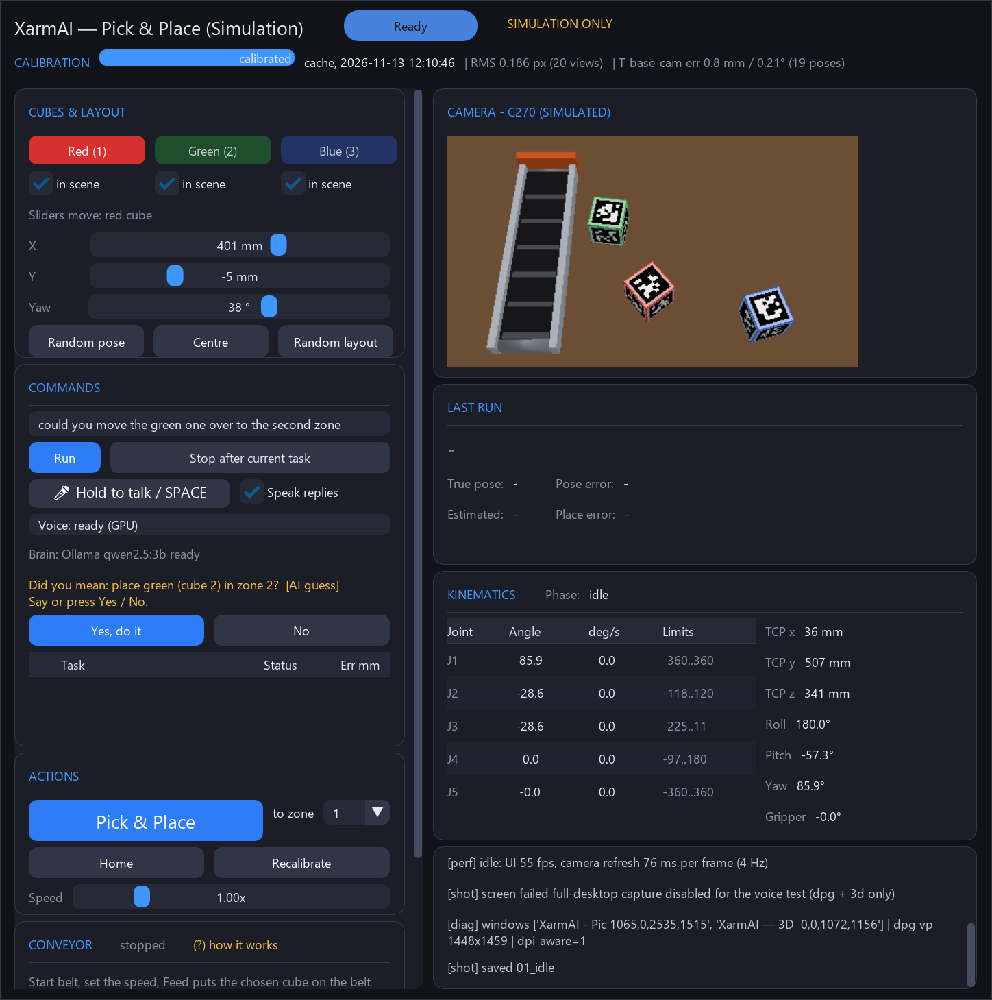
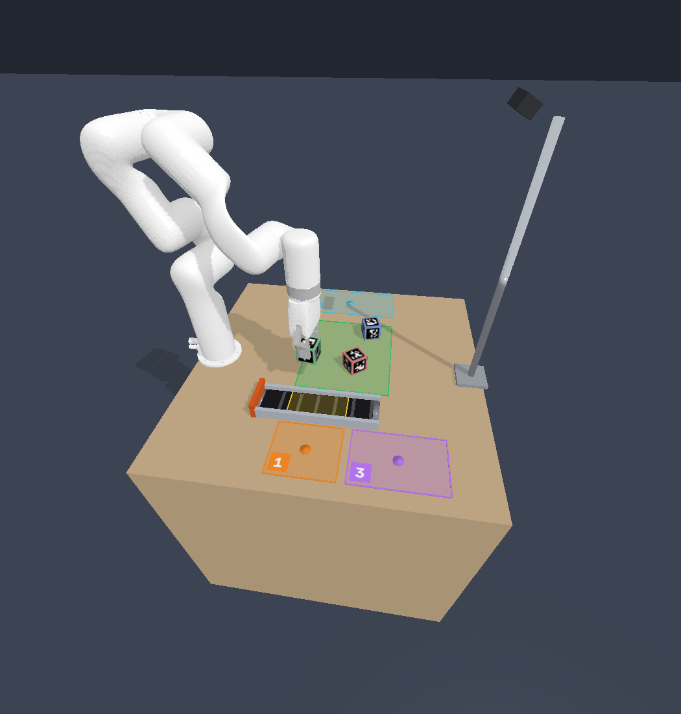

# XarmAI - xArm 5 pick-and-place simulator with voice and a local AI brain

**SIMULATION ONLY.** No real robot and no real camera are used. The camera is a Logitech C270 model built from public specs plus
PLACEHOLDER noise, the grasp is a kinematic attach (no contact physics), the gripper is the xArm Gripper as a stand-in, IK is PyBullet.

A PyBullet + Dear PyGui simulation of a UFACTORY xArm 5 that sees AprilTag-marked cubes through a simulated C270 camera, calibrates
the camera against the robot, plans grasps, and picks and places one or several cubes. You can give commands by typing or by
push-to-talk voice (faster-whisper, offline). A local LLM (Ollama, `qwen2.5:3b`) can interpret free-form sentences, but it only
proposes actions: nothing moves until you confirm. A simulated conveyor belt lets the robot catch a moving cube.

| Control window (command + confirm) | 3D view |
|---|---|
|  |  |

## Requirements
- Windows 10 or 11 (the installer and TTS are Windows-specific)
- Python 3.12 (the installer can fetch it, see below)
- Optional: NVIDIA GPU for fast voice (otherwise voice runs on CPU)
- Microphone for voice (typing works without)
- About 3 GB disk (about 5 GB with the NVIDIA wheels, Whisper model and Ollama model)

## Quick start
```bat
git clone https://github.com/MathewChunkathil/XarmAI.git
cd XarmAI
install.bat
run_app.bat
```
`install.bat` creates `.venv`, installs the packages and runs a smoke check. It is safe to run again. The first app start calibrates the
simulated camera once (about 2.5 min, progress bar; Pick is disabled until done) and caches it in `results/sim_calib/sim_calib.json`.
After that the app is ready in about 1 s.

### Installer switches
Pass them to `install.bat` (or call `powershell -ExecutionPolicy Bypass -File install.ps1 <switches>`).

| Switch | What it does |
|---|---|
| `-InstallPython` | install Python 3.12 with winget if it is missing |
| `-Whisper` | pre-download the voice model `small.en` (~480 MB) into `models/whisper` |
| `-Ollama` | install Ollama (winget) if missing, start it, `ollama pull qwen2.5:3b` (~1.9 GB) |
| `-All` | `-Whisper` and `-Ollama` |
| `-CpuOnly` | skip the NVIDIA CUDA wheels (`requirements-gpu.txt`, ~1 GB). Without this switch they are installed only if `nvidia-smi` finds a GPU |
| `-Test` | run `pytest -q tests/unit -x` at the end |

Manual install instead: `py -3.12 -m venv .venv`, then `.venv\Scripts\python -m pip install -r requirements.txt` (and `-r requirements-gpu.txt` on NVIDIA).

## Using the app
Start with `run_app.bat` (same as `.venv\Scripts\python -I scripts\sim_app.py`). Left: 3D view (view only, green PICK zone, orange PLACE zones).
Right: control window (scroll with the mouse wheel if the window is small).

- **Cubes**: three identified cubes (red 1, green 2, blue 3) and three place zones. Pick pose sliders (x, y, yaw), Random pose, Pick & Place, Home, Recalibrate, speed 0.25x-4x (playback only).
- **Commands** (type in the Commands box, Run or Enter; tasks run one after another):
  - `place the red cube in zone 1`
  - `put the green cube in zone 2 and stack red on green`
  - `move all cubes to zone 3` / `stack all cubes in zone 1` / `put blue on top of red` / `home`
  - Errors (unknown cube, cube not in scene, zone out of range, stack > 3 high) are shown and nothing runs.
- **Voice**: hold **Hold to talk** (or hold SPACE while the window is focused and the text box is not), speak, release. Text appears as "Heard: ...".
  Spoken commands always ask `Did you mean: ...?`. Answer with the **Yes, do it / No** buttons or by voice (`yes`, `no`, `cancel`).
  Anything else counts as a new command.
- **AI brain**: the rule parser tries first. If it cannot parse, a local LLM (Ollama `qwen2.5:3b`, `config/ai.yaml`) proposes whitelisted tasks, which go through the
  same validation and need your confirmation. If Ollama is offline the app falls back to fuzzy spelling correction + rules; a line under the voice meter shows
  `Brain: Ollama qwen2.5:3b ready` or `Ollama offline - rules only`. Set `provider: none` in `config/ai.yaml` to disable the LLM.
- **Speak replies**: tick the checkbox to hear replies (Windows text-to-speech).
- **Conveyor, step by step** (panel at the bottom of the left column, scroll down):
  1. Press **Start belt** and set the speed (0-6 cm/s).
  2. Choose a cube and press **Feed cube** (it appears at the belt start).
  3. Tick **Pick from belt to zone N** to auto-catch it, or just say/type `pick the green cube from the belt and place it in zone 2`.
  4. The robot tracks the cube with the camera, estimates its speed, intercepts and places it. Other commands: `start the conveyor`, `stop the belt`, `set conveyor speed to 4 cm per second`, `feed the red cube onto the conveyor`.
  Details in [sim/README.md](sim/README.md).

## Headless scripts
All run from the repo root with the venv Python (`-I` = isolated mode, as the docs do):
```bat
.venv\Scripts\python -I scripts\sim_demo.py --runs 10 --seed 0                  :: scored single-cube batch (~3 min) -> results/sim_demo/
.venv\Scripts\python -I scripts\sim_demo.py --conveyor-runs 10 --conveyor-speed 0.02,0.04,0.06   :: conveyor batch -> results/sim_conveyor/
.venv\Scripts\python -I scripts\make_report.py --last 10                        :: PDF report from the newest kin logs -> results/reports/
.venv\Scripts\python -I scripts\make_tags_pdf.py                                :: printable AprilTag sheet -> results/tags/
```
Every run also writes a kinematics validation log to `results/kin_logs/` (git-ignored).

## Tests
```bat
.venv\Scripts\python -I -m pytest -q tests/unit tests/sim/test_conveyor.py tests/sim/test_multi_cube.py
```
Expected: 260 passed (about 2 min; one extra voice-model test is skipped when the Whisper model is not downloaded). `-Test` on the installer runs only `tests/unit`.

## Project layout
```
install.bat / install.ps1   one-step installer          run_app.bat   start the app
requirements.txt            base packages               requirements-gpu.txt   optional CUDA libs for GPU voice
scripts/   sim_app.py (GUI), sim_demo.py (batch), make_report.py, make_tags_pdf.py, measurement scripts
sim/       PyBullet world, camera, conveyor, commands, voice, intent (LLM), tts, trajectories, kin logs, URDF
src/       pure-Python modules reused later in ROS 2: cube_perception, calibration_tools, candidate_evaluator
config/    camera, cube(s), gripper, planning/ranking, workspace, ai.yaml
tests/     unit/ and sim/
docs/      demo script, V1 overview, screenshots
results/   outputs (most git-ignored); models/whisper/ voice model cache (git-ignored)
```
Config files are YAML and mostly PLACEHOLDER values: `config/workspace/workspace.yaml` (zones, conveyor), `config/camera/c270_sim.yaml`,
`config/cube/cubes.yaml`, `config/planning/planning.yaml`, `config/ai.yaml` (LLM provider, model, confirm rules).

## Troubleshooting
- **No microphone / voice button disabled**: the tooltip says why. Plug in a mic, restart the app. Typing still works.
- **CUDA DLL errors (cublas / cudnn)**: run `install.bat` on a machine with an NVIDIA GPU (installs `requirements-gpu.txt`). On failure voice falls back to CPU automatically; `install.bat -CpuOnly` forces CPU.
- **Voice says "loading..." for a long time on first start**: it is downloading `small.en` (~480 MB). Pre-download with `install.bat -Whisper`.
- **Brain shows "Ollama offline"**: run `install.bat -Ollama`, or start the Ollama app. Rules still work.
- **Window too small / controls cut off**: scroll the control window with the mouse wheel (conveyor panel is at the bottom).
- **First start is slow**: camera calibration runs once (about 2.5 min) and is cached. Delete `results/sim_calib/sim_calib.json` or press Recalibrate to redo.
- **Hugging Face symlink warning on download**: harmless.
- **PowerShell says scripts are disabled**: use `install.bat` (it bypasses the policy for that one run only).

## Docs
- [sim/README.md](sim/README.md) - detailed simulator, conveyor, voice, kin-log docs
- [docs/DEMO_SCRIPT.md](docs/DEMO_SCRIPT.md) - 5-minute demo script
- [SIM_DEMO_PLAN.md](SIM_DEMO_PLAN.md), [IMPLEMENTATION_PLAN.md](IMPLEMENTATION_PLAN.md), [ARCHITECTURE_OVERVIEW.md](ARCHITECTURE_OVERVIEW.md)
- Spec: [01 Project](01_PROJECT_SPECIFICATION.md), [02 Architecture](02_SYSTEM_ARCHITECTURE.md), [03 Software](03_SOFTWARE_AND_REPOSITORY.md),
  [04 Robot/tool](04_ROBOT_AND_TOOL_INTEGRATION.md), [05 Vision](05_VISION_AND_CALIBRATION.md), [06 Grasp/motion](06_GRASP_AND_MOTION_PLANNING.md),
  [07 Digital twin](07_DIGITAL_TWIN_AND_SIMULATION.md), [08 Safety](08_EXECUTION_SAFETY_AND_RECOVERY.md), [09 Experiments](09_EXPERIMENTS_AND_METRICS.md),
  [10 Roadmap](10_DEVELOPMENT_ROADMAP.md), [11 Decisions](11_DECISIONS_AND_OPEN_QUESTIONS.md)
- [docs/PROJECT_OVERVIEW_V1.md](docs/PROJECT_OVERVIEW_V1.md) - the original Version 1 project overview (real-robot scope)

## License
MIT License - see [LICENSE](LICENSE).
